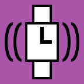
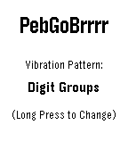

 

# PebGoBrrrr

You know that moment when you're half asleep, trying to decide whether you can get away with a little more sleep, but checking the time would wake you up completely?

PebGoBrrrr is built for exactly that. Launch it with a button press and it vibrates the current time straight to your wrist. No bright screen, no squinting, no fully waking up just to find out it is 4:17.



Pick your preferred vibration pattern, tweak the buzz timing, and let your Pebble whisper the time at you through pure brrrr.

You can grab the compiled `.pbw` over on the [Rebble App Store](https://apps.repebble.com/pebgobrrrr_faa7fc596f704d099f1a9f2e).

## Features
- **Vibration-only time telling:** Keep your eyes closed, stay half-asleep.
- **Customizable buzzes:** Pick your preferred vibration pattern.
- **Timing tweaks:** Adjust the delays so your half-asleep brain can actually process the time.
- **Zero tracking:** Because I don't want to track you, and you don't want to be tracked. 

## Building from Source
It's standard Pebble SDK stuff. If you know, you know.
```bash
pebble build
pebble install --phone [YOUR_PHONE_IP]
```

## License
Released under the [MIT License](LICENSE). 
TL;DR: Do whatever you want with this code. Just don't sue me if it makes your watch explode (it won't), and keep the license file intact.

## Polite Note
Please be kind, I am not a professional programmer 😬

Crafted with ❤️ by turtwig | [legitimate.download](https://legitimate.download/)